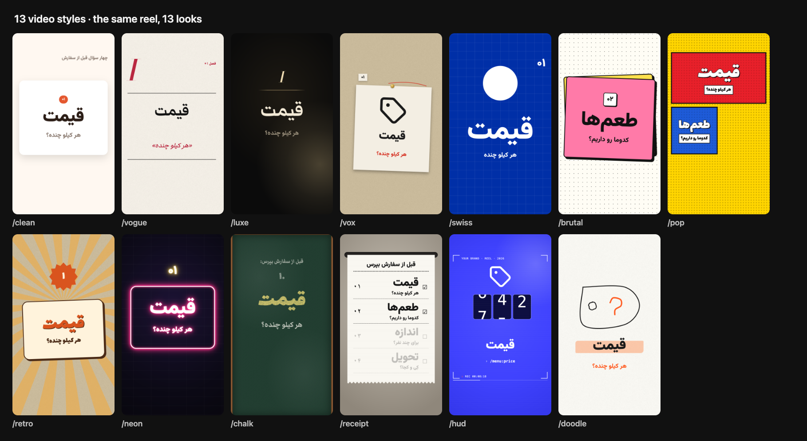
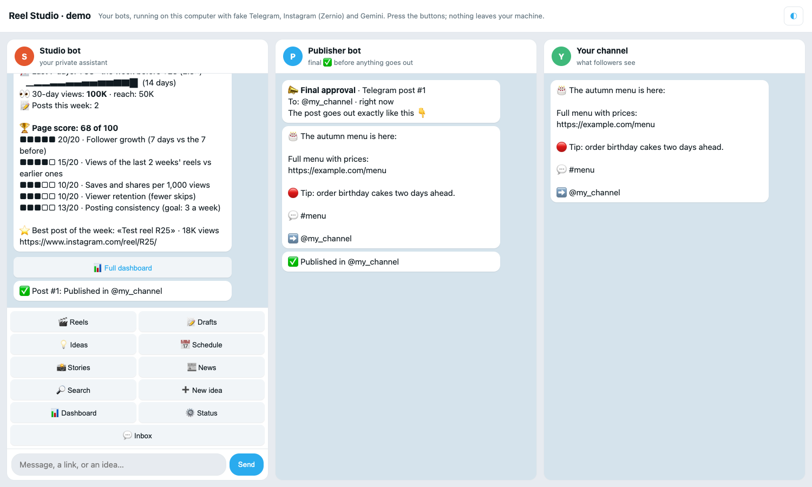
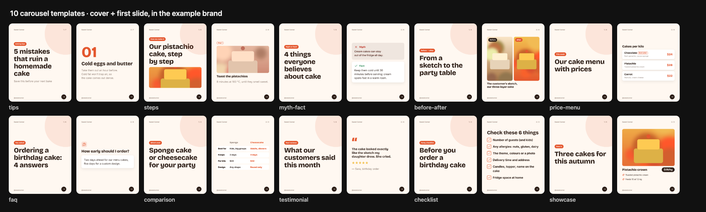
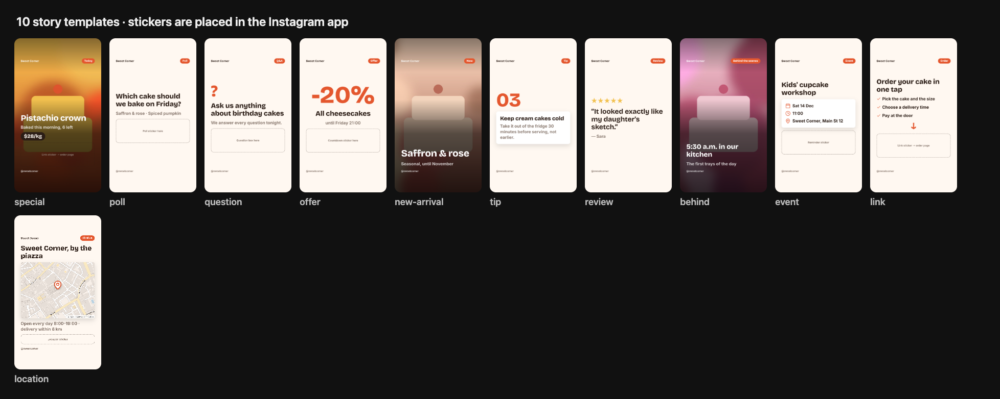
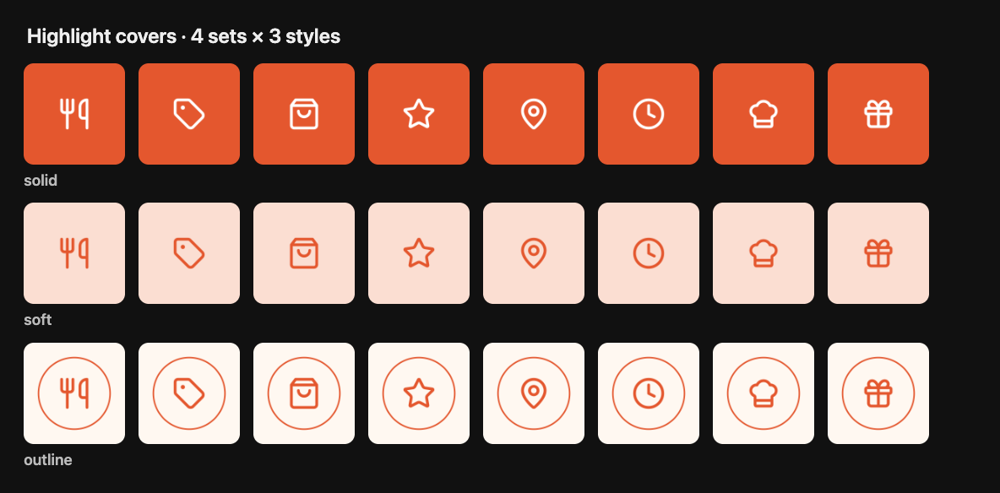
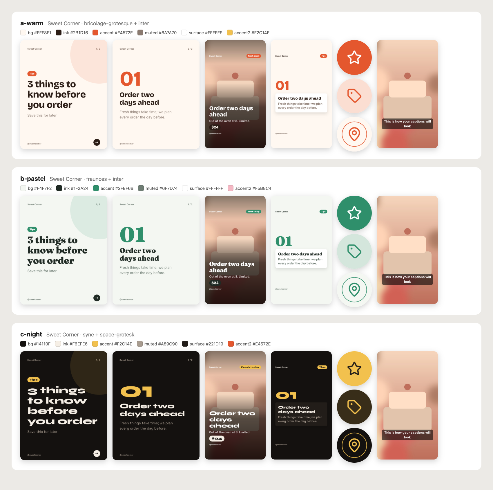

# Reel Studio

**A content studio for Instagram, YouTube Shorts and Telegram that runs inside Claude Code.** It learns your brand (your
site, your page, your files), writes in your voice, edits reels in 13 motion styles, makes carousels, stories and
highlight covers in your colours and fonts, publishes after your ✅, and sends you the numbers every morning. For any
business: a bakery, a restaurant, a photo studio, a salon, a clinic, a shop, an expert, or an agency with many clients.

**Guide:** [English](docs/guide/en.md) · [فارسی](docs/guide/fa.md) · [العربية](docs/guide/ar.md) · [Türkçe](docs/guide/tr.md) · [Deutsch](docs/guide/de.md) · [Français](docs/guide/fr.md) · [Italiano](docs/guide/it.md)



## Try it in five minutes, no accounts

```bash
git clone https://github.com/mjamali97/reelstudiokit.git my-studio && cd my-studio
bash tools/install.sh                 # checks your computer, installs the core tools
bash telegram-bot/demo/demo.sh        # your bots, running locally with fake Telegram, Instagram and Gemini
```

Or from inside Claude Code, as a plugin: `/plugin install reel-studio --marketplace mjamali97/reelstudiokit`, then
`/reel-studio:start` (it clones the kit into a folder of your choice and installs the tools).

A browser page plays Telegram: press the buttons, approve a post, watch it reach the channel, open the dashboard, answer a
comment. Nothing leaves your computer. Then open the folder in Claude Code (`claude`) and type `/demo` or `/setup`.



## What it makes

**Carousels:** 10 templates, 1080×1350, written in your voice, rendered in your brand.



**Stories and highlight covers:** 11 story templates (one draws a map of your shop from OpenStreetMap) with room for the sticker, 4 highlight sets in 3 styles.




**Your brand, read from what you already have:** `/setup` reads your website, Instagram and brand files, then shows your
brand on real frames, or three directions side by side to choose from.



## How it works

| step | you type | what happens |
|---|---|---|
| set up once | `/setup` | reads your site, page and files → "here is what I understood" → your voice (with a sample test) → your design system → a first audit → your formats and a two-week plan → Zernio and two Telegram bots, in test mode first |
| plan | `/content-plan` | the week's reels, carousels and stories from your business playbook (20 included), plus the shot list |
| make | `/reel-idea` `/reel-style` `/carousel` `/story` `/captions` | checked facts → a script in your voice → a styled edit or slides, QA-checked before you see it |
| publish | `/publish` | a Zernio draft and a card in your Telegram bot; one ✅ schedules Instagram + YouTube + the comment-to-DM gate; Telegram posts get a second, final ✅ |
| learn | `/analytics` `/page-audit` | your numbers → what worked → updated hooks, styles, posting times; a monthly audit with the top 5 fixes |

**In Telegram, every day:** a 09:00 report (followers, trend, a page score out of 100), a report 24 h and 7 days after each
post, comments and DMs with a suggested reply in your voice, a weekly competitors report, a monthly PDF, a content
calendar and a private dashboard. The bot speaks English, Persian, Arabic, Turkish, German, French and Italian.

**Agency mode:** one folder per client (`node tools/client.mjs`), one bot for all of them, each client's own voice in the
inbox, their own reports and dashboard link. See [playbook/AGENCY.md](playbook/AGENCY.md).

## Inside

| | |
|---|---|
| `.claude/skills/` | 28 skills: onboarding, planning, 13 video styles, carousels, stories, captions, licensed assets, publishing, analytics, audits, updates |
| `playbook/` | the runbooks behind them, and 20 business playbooks (restaurant, bakery, photo studio, online shop, salon, clinic, gym, real estate, florist, jewellery, travel, weddings…) |
| `tools/` | renderers (carousels, stories, captions), brand tools (extract from a website, palette from images, preview, apply), the HyperFrames reel engine, QA, Zernio CLI, agency folders |
| `fonts/` + `assets/` | 51 open-licence font families (Latin, Persian incl. Nastaliq, Arabic), ~7,000 icons, CC0 illustrations recoloured to your brand, Noto emoji; `tools/assets/fetch.mjs` for CC0/stock photos, video, music and sound effects with a credits file |
| `telegram-bot/` | the two bots (Cloudflare Worker, free tier), 200+ local checks, the demo |
| `examples/bakery/` | a complete fictional brand: profile, voice, every template rendered |

Everything it relies on (HyperFrames, WhisperX, Playwright, the Persian typography linter, the NextWork editor plugin…)
is listed with its licence and pinned version in [tools/STACK.md](tools/STACK.md) and installed by `tools/install.sh`.

## Requirements

macOS, Linux or Windows (WSL2); git, Node 20+, Python 3.11+, ffmpeg, Google Chrome, uv; Claude Code. To go live: an
Instagram professional account, [Zernio](https://zernio.com), Telegram, a free Gemini key, free Cloudflare and GitHub
accounts. The kit is free; you pay for Claude, and for Zernio beyond its free tier.

## Safety

Nothing is published without your ✅ (twice for Telegram), and uploads are drafts. Keys live in `.env` and in your GitHub
and Cloudflare secrets, never in the chat or in git. Only facts with a source go on screen or in a caption. The kit contains
no personal data. Bot tests run against fakes: `bash telegram-bot/test/all.sh`. Report a vulnerability: [SECURITY.md](SECURITY.md).

## Updates, contributing, licence

`/update` pulls new versions and keeps your profile, brand, formats and reels ([CHANGELOG.md](CHANGELOG.md)).
Contributing: [CONTRIBUTING.md](CONTRIBUTING.md). MIT licence ([LICENSE](LICENSE)); fonts, icons and libraries keep
their own licences ([THIRD_PARTY_NOTICES.md](THIRD_PARTY_NOTICES.md)).
